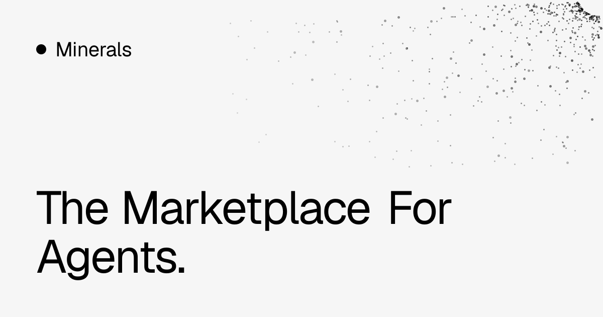

<p align="center">
  <a href="https://minerals.dev"></a>
</p>

<h1 align="center">Minerals</h1>

<p align="center">
  One connection. Every request is routed to the right library or tool.
</p>

<p align="center">
  <a href="https://minerals.dev">Website</a> ·
  <a href="https://minerals.dev/connect">Connect</a> ·
  <a href="https://minerals.dev/how-it-works">How it works</a> ·
  <a href="https://minerals.dev/supply">List your work</a> ·
  <a href="https://minerals.dev/changelog">Changelog</a>
</p>

<p align="center">
  
  
  
  
</p>

## What it is

Minerals is one MCP server for design work. Connect it once to Claude Code, Cursor or Codex. When your agent is about to choose, install or write a UI component, a texture, an animation or another design element, it asks Minerals, and Minerals routes the request to a library or tool made for exactly that.

- **Curated.** Every listing is added and judged by hand.
- **Light.** At most three results, best first. One offer per session. Nothing is added without your yes.
- **Pass-through.** Files come straight from their makers. Minerals never holds them.
- **Open.** One connection, no sign-in.

## Connect

The quick way: paste this to your agent.

```
Connect Minerals for all my projects: read https://minerals.dev/install.md and follow it, then suggest one free item for this project.
```

Or add the server yourself:

**Claude Code**

```bash
claude mcp add --scope user --transport http minerals https://minerals.dev/mcp
```

**Cursor**

[](https://cursor.com/en/install-mcp?name=minerals&config=eyJ1cmwiOiJodHRwczovL21pbmVyYWxzLmRldi9tY3AifQ%3D%3D)

Or add this to `~/.cursor/mcp.json`:

```json
{ "mcpServers": { "minerals": { "url": "https://minerals.dev/mcp" } } }
```

**Codex**

```bash
codex mcp add minerals --url https://minerals.dev/mcp
```

### Also a plugin, a skill and a shadcn item

```bash
# Claude Code plugin
/plugin marketplace add Mineralsdev/minerals
/plugin install minerals@minerals

# Agent skill
npx skills add Mineralsdev/minerals

# shadcn
npx shadcn@latest add Mineralsdev/minerals/connect
```

## How it works

1. **Your agent asks.** It sends a few keywords when the work calls for it. Never code or files.
2. **The request is routed.** It goes to the listings that fit the task. At most three come back, best first.
3. **You say yes.** The agent asks once, in one line.
4. **The file comes from its maker.** Minerals never holds it.
5. **Then it stays out of the way.** At most one offer per session, and "Not now" is remembered.

## On the shelf

| Listing | Maker | Best for |
|---|---|---|
|  [Fluid Functionalism](https://www.fluidfunctionalism.com) | @micka_design | Refined product interfaces with one consistent hover feel across buttons, tables, dialogs and sidebars. |
|  [Textures.dev](https://textures.dev/) | Textures.dev | Animated, hover-reactive brand textures for websites. Each one is a single React component that coding agents like Claude Code, Cursor and Codex add to your project with one prompt. |
|  [Blossom Carousel](https://www.blossom-carousel.com/) | Jesper Vos | A carousel that keeps the browser's own scrolling and adds dragging with a mouse. Layout, snapping and spacing stay in your CSS. |
|  [Libraries.dev](https://libraries.dev/) | Jakub Antalik | Effects for AI interfaces in React: a glowing border while it streams, thinking orbs while it works, and voice and avatar pieces. |
|  [Sticky Scroll](https://sticky.jesperlandberg.com/) | Jesper Landberg | Sticky elements that ease into place and out again instead of stopping dead. One file, no dependencies. |
|  [UIArc](https://uiarc.dev/) | Elia Kuratli | Animated components and blocks for marketing pages on shadcn and Next.js. |
|  [Details.so](https://www.details.so/) | Details.so | References from real websites, and copy-ready page transitions, preloaders and parallax. |
|  [DialKit](https://www.dialkit.dev) | Josh Puckett | Tuning spacing, motion and colour live beside the interface. |
|  [Twombly](https://twombly.app) | Materic, Inc. | Sharing a prototype or an agent's design explorations with other people to compare, review and give feedback on a shared canvas. |

The live shelf, with every item, is at [minerals.dev](https://minerals.dev).

## The tools

| Tool | What it does |
|---|---|
| `find_design` | Minerals: the marketplace for agents. It routes each design request to the right library or tool. |
| `get_listing` | For an item ref (listing/item) returns the exact pull instruction and the license link. |
| `report_outcome` | After get_listing, say whether you used what was recommended. |
| `offer` | Offer your person one free item, or one listing, as a short choice: Yes or Not now. |
| `suggest_listing` | Propose a design library or tool for Minerals. |

## What is sent, what is fetched

What is sent: a few keywords, any filter you set (section, listing, kind, free only), stack names, one project type and stage label, the moment the work is at, the refs and settings already in minerals.json (what is installed, what was accepted or declined, and quiet), whether your person asked to replace something, your client's name, the install key when the connect line carries one, and which path asked (for example, the install guide's first run). No code, files or repo name.

Nothing is pulled without a yes. On a yes, the file comes straight from its supplier. Minerals never holds it. A pull goes through a Minerals address that records it and redirects to the supplier. More in the [privacy policy](https://minerals.dev/privacy).

## For makers

Made something an agent should reach for? Listing is free, and every listing is added and judged by hand. [Send it in](https://minerals.dev/supply).

## Licence

The files in this repo are under the MIT licence. Each listing keeps its own licence, named on its page. Contact: hello@minerals.dev
